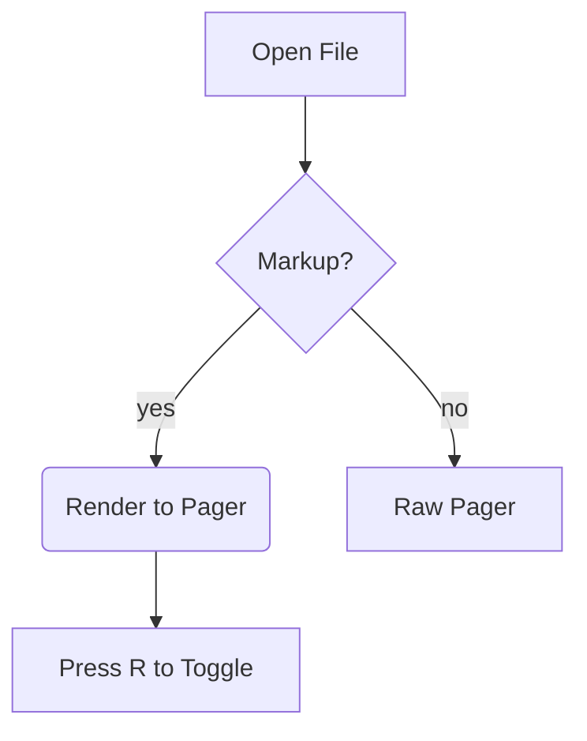

# Tam-View 0.2.0 Demo

Welcome to **tam-view**! This is a *Markdown* document with `inline code`, a [Tamlinux link](https://tamlinux.org), and wrapped paragraphs that adapt to your terminal width.

## Features

- Auto-renders `.md`, `.html`, and `.mmd` files by default
- Press `R` inside the pager to toggle between **rendered** and **raw** views
  - Works with `/` search, `n`/`N`, marks, and `:n`/`:p` file navigation
- Pass `-r` / `--raw` for raw text, `-R` / `--render` to force rendering, or `--ascii` for kernel console output

> Note: Redirected stdout stays a byte-for-byte copy unless `-R` or `--render` is passed.

---

## Comparison Table

| Mode | Flag | Default Behavior |
| --- | --- | --- |
| Auto | (none) | Renders markup, keeps plain text raw |
| Raw | `-r`, `--raw` | Always shows raw source |
| Render | `-R`, `--render` | Forces rendering (even on plain text / pipes) |

## Embedded Mermaid Flowchart



## Sample Code

```c
int main(void) {
    return 0;
}
```
